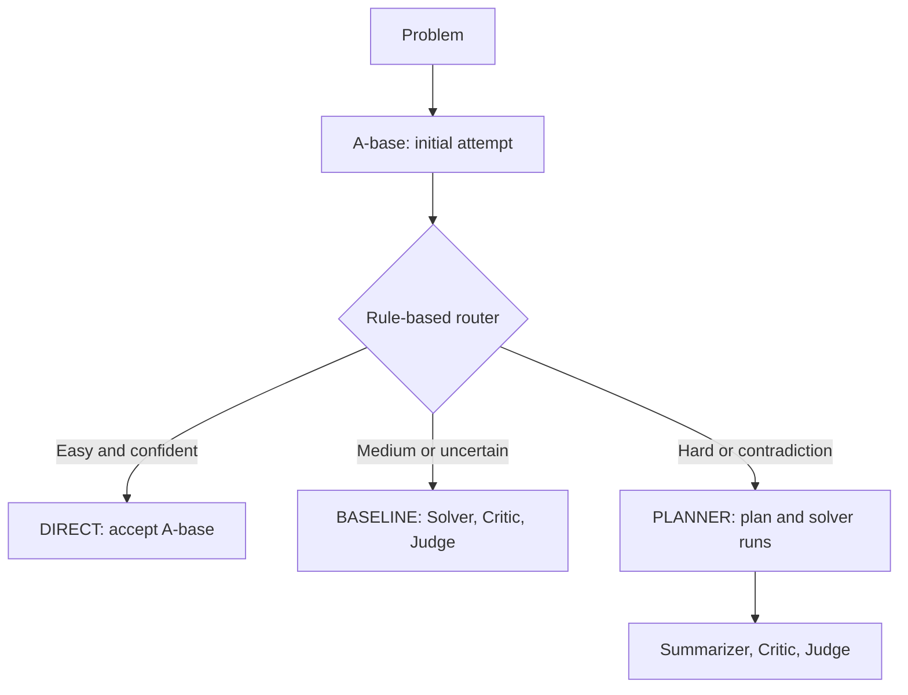

# Cost-Aware Multi-Agent Math Reasoning

A course research project exploring when additional LLM agents are worth their computational cost. We compare a fixed Solver - Critic - Judge pipeline with an adaptive system that uses a quick first attempt to route math problems to different workflows and model budgets.

**Python · LLM APIs · Multi-agent orchestration · Prompt design · Dynamic routing**

The final report records higher accuracy and lower estimated API cost with a routed model mix, despite higher token usage. A subsequent prompt revision reduced the advanced system's token usage by 5.9%. These are historical, report-sourced results, not newly reproduced measurements.

[Read the final report](docs/final_report.pdf) · [Results and reproducibility](docs/RESULTS.md) · [Dataset notes](data/README.md)

## Why this project

Applying the same multi-agent workflow to every problem can spend unnecessary calls on easy questions. This project explores using an initial answer and difficulty estimate to reserve additional computation for harder problems. It also examines a practical distinction: fewer tokens and lower dollar cost are not the same objective when different models have different prices.

## System design

The baseline always calls **Solver → Critic → Judge**. In the supplied implementation, scoring uses the Solver's answer; the Judge produces a diagnostic label and explanation rather than replacing it.

The advanced pipeline first calls **A-base**, which returns a provisional answer, difficulty, confidence, flags, and a short reusable summary. A deterministic router then chooses a workflow:



| Route | Selection rule in this code | Final answer source |
| --- | --- | --- |
| DIRECT | EASY, confidence ≥ 0.8, and no negative flags | A-base provisional answer |
| PLANNER | HARD / VERY_HARD, or CONTRADICTION_DETECTED | Most frequent nonempty Solver answer; A-base fallback |
| BASELINE | All other cases | One Solver answer |

DIRECT is checked first. The SoftPlanner selects a solver budget and model list for the PLANNER route. The code supports multiple solver attempts; the report describes restricting hard cases to one. Use `--max_hard_runs 1` for that budget.

Implementation details that matter:

- Routing itself is Python logic, not an additional LLM meta-planner call.
- Critic and Judge are diagnostic in the advanced code too; they do not override the selected answer. They run together only when both are enabled.
- The PLANNER Summarizer is called, but its output does not determine the final answer. The generated plan is not passed into the Solver; the Solver receives A-base's summary.
- Prompts mention a Python calculator, but these scripts do not execute a calculator or implement tool calling. The optional baseline retriever is an empty stub, not a RAG system.

## Reported findings

| Main experiment: 150 questions | Fixed baseline | Routed system, original prompts |
| --- | ---: | ---: |
| Model setup | GPT-4.1 | GPT-4.1-mini / GPT-4.1 mix |
| Accuracy reported in Table 4 | 30.0% | 36.0% |
| Average runtime per question | 31.54 s | 25.17 s |
| Total tokens | 785,042 | 1,237,331 |
| Approximate total API cost at experiment-time prices | $5 | $1 |

For the advanced system, prompt revision reduced total tokens from **1,237,331 to 1,164,019 (5.9%)**, while re-evaluated accuracy rose from **36.0% to 38.67%**. Average runtime was 25.45 s after revision. A separate 100-question text-only check reported 41% baseline accuracy and 47% advanced accuracy, with higher advanced token usage and runtime.

The main set contains diagram-dependent questions, but the experiments supplied text only. Routing and model choice changed together, so these comparisons do not isolate the effect of routing alone. See [RESULTS.md](docs/RESULTS.md) for the scoring and reproducibility limitations.

## Quick start

Use Python 3.10 or newer. Run commands from this repository's root folder.

```bash
python -m venv .venv
```

Activate on Windows PowerShell:

```powershell
.venv\Scripts\Activate.ps1
```

Or on macOS / Linux:

```bash
source .venv/bin/activate
```

Install the core dependencies:

```bash
python -m pip install -r requirements.txt
```

Set your API key in the terminal used to run Python. PowerShell:

```powershell
$env:OPENAI_API_KEY = "your-key-here"
```

macOS / Linux:

```bash
export OPENAI_API_KEY="your-key-here"
```

`.env.example` documents the variable name; the scripts do **not** automatically load `.env` files. API runs incur provider charges. The model names below match the historical project setup; access depends on your account.

### Try one simple problem

```bash
python math_solver_advanced_universal.py --provider openai --prompts prompt_advanced.yaml --baseline_model gpt-4.1-mini --a_base_model gpt-4.1-mini --planner_model gpt-4.1-mini --hard_model gpt-4.1 --max_hard_runs 1 --question "What is 2 + 3?" --output results/advanced_demo.jsonl
```

### Compare both pipelines on the included smoke-test data

```bash
python math_solver_baseline_universal.py --provider openai --model gpt-4.1 --data data/smoke_test.json --prompts prompt.yaml --out_jsonl results/baseline_smoke.jsonl
python math_solver_advanced_universal.py --provider openai --prompts prompt_advanced.yaml --baseline_model gpt-4.1-mini --a_base_model gpt-4.1-mini --planner_model gpt-4.1-mini --hard_model gpt-4.1 --max_hard_runs 1 --data data/smoke_test.json --output results/advanced_smoke.jsonl
```

The three smoke-test questions are simple functional examples, not a benchmark. Larger supplied examples live in `data/custom_math_200.json` and `data/frontiermath_10.json`; read the dataset notes before using them for evaluation.

Both programs accept `--help`. OpenAI is the documented setup here. Other provider adapters are present in the source but have not been verified in this packaging pass; the Gemini adapter requires an additional SDK not included in the core requirements.

## Files

| Path | Purpose |
| --- | --- |
| `math_solver_baseline_universal.py` | Fixed three-agent pipeline and baseline logging |
| `math_solver_advanced_universal.py` | A-base, routing, planning, solver orchestration |
| `prompt.yaml` / `prompt_advanced.yaml` | Supplied role prompts, preserved unchanged |
| `data/` | Supplied sample files, smoke test, and provenance notes |
| `results/` | Local run outputs, ignored by Git |
| `docs/final_report.pdf` | Original submitted report, preserved unchanged |
| `docs/RESULTS.md` | Historical metrics and reproducibility gaps |
| `docs/prompt_history/` | Archived advanced YAML and early Word design drafts; not runtime defaults |

## Prompt design history

The `docs/prompt_history/` folder preserves earlier design materials alongside the runnable YAML configurations at the repository root:

| Archived file | Purpose |
| --- | --- |
| `prompt_advanced_old.yaml` | Alternate advanced configuration, supplied with the label "Old" |
| `baseline_prompt_draft.docx` | Early baseline role definitions and input/output design |
| `advanced_prompt_draft.docx` | Early A-base signals, routing rules, and planner design |

The archived YAML differs from the root `prompt_advanced.yaml` in **Critic, Judge, and Summarizer** instructions. It includes stronger brevity constraints, such as a 1-2 sentence Judge explanation, and shorter Summarizer instructions. Its A-base, SoftPlanner, and Solver YAML sections match the root version. Thus, the "Old" label alone does not establish which configuration produced the report's original or revised results. The reported 5.9% token saving remains a report-sourced observation, not a measured comparison of these two archived files.

The Word files document the design process, not executable configuration. For example, the advanced draft discusses a 0.7 confidence threshold and different routing rules; the current code's DIRECT route uses 0.8 and EASY difficulty. Draft descriptions of calculator execution, caching, or plan reuse should not be interpreted as implemented features.

Keep the root YAML files as the default runtime configuration. The historical material helps document the team's progression from role and interface design to a runnable pipeline. The reproducibility discussion in `docs/RESULTS.md` still applies: although another prompt variant is now archived, the exact historical original/revised pair and its run mapping remain unverified.

## Evaluation and current limitations

The baseline saves token counts, diagnostic outputs, and normalized answer comparisons. The advanced script saves route metadata and timing, but its CLI output does not aggregate or persist token totals. Its displayed accuracy uses stripped string equality. These two built-in accuracy summaries are therefore not a consistent benchmark scorer and should not be directly compared as such.

The exact OlympiadBench subsets, historical run logs, and post-hoc scoring script are not included. Two advanced YAML variants are available (the root configuration and an archived file supplied as "Old"), but their correspondence to the report's original/revised experiments has not been verified. This release supports running the supplied workflows, but does not reproduce the report's tables end to end. Model outputs may vary between runs. No live API experiment was performed during repository preparation.

Next steps include a shared answer evaluator, per-agent token logging, paired prompt versions, and experiments that separate routing gains from model-mix effects. The supplied sample answer keys also need auditing before benchmark use.

## Team contributions

As documented in the final report:

- **Alan Zhang:** led architecture and routing design, wrote and iterated on all agent prompts, and coordinated integration.
- **Xinmeng Tan:** implemented Python orchestration and logging, ran experiments, and debugged the pipeline.
- **Young Liu:** conducted literature review and data/resource collection, and contributed design and workflow refinements.

All team members contributed to the initial system design. This is a team course project, not a claim of sole authorship.

## Report and attribution

The final report documents the project’s methods, experiments, and findings. It contains the experimental discussion, references, and AI assistance disclosure. This repository has no project-wide license file yet; no license for third-party data is inferred from its inclusion.
